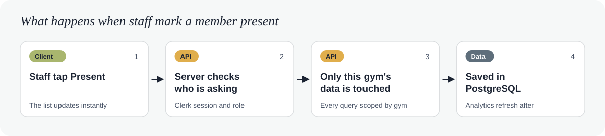
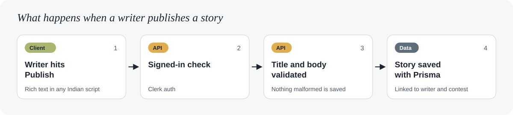
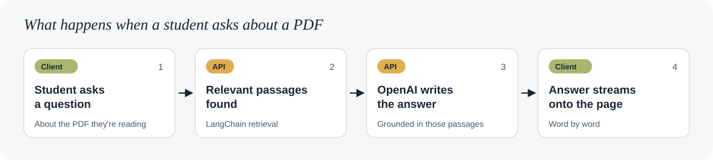
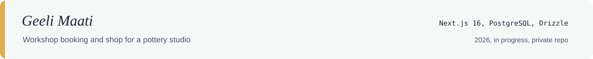
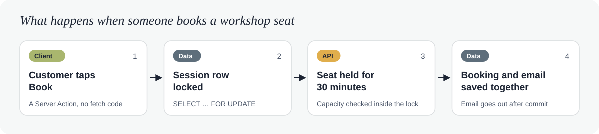

<!-- Generated by scripts/build.mjs. Edit that, then run: node scripts/build.mjs -->

  

  <a href="https://manishsingh-tau.vercel.app/">Portfolio</a> &nbsp;/&nbsp;
  <a href="https://linkedin.com/in/singh-manish1">LinkedIn</a> &nbsp;/&nbsp;
  <a href="mailto:smanish14322@gmail.com">smanish14322@gmail.com</a> &nbsp;/&nbsp;
  Bhopal, India

## The stack, top to bottom

- **Appbrew**: cross-platform apps in React Native on the new Fabric architecture.
- **Braktt**: React and Next.js dashboards, a reusable component library, and a 25% cut in Largest Contentful Paint through lazy loading, code splitting and asset optimization.
- **Repset**: optimistic updates with React Query for 30% faster interactions.
- **Rachnakaar**: a rich text editor with full support for Indian scripts.

React, Next.js, React Native, TypeScript, Tailwind CSS, Material UI, Framer Motion, React Query, Redux Toolkit, Zustand

- **Repset**: API routes with role-based access through Clerk, scoped to each gym.
- **Braktt**: JWT authentication flows and protected routes.
- **Gurukool**: question answering over uploaded PDFs with LangChain and OpenAI.
- **Geeli Maati**: Server Actions over a service layer, with Zod validation at the edge.

Node.js, Next.js Server Actions and Route Handlers, REST APIs, tRPC, Zod

- **Repset**: a PostgreSQL schema for a multi-tenant SaaS.
- **Rachnakaar**: a Prisma data model for writers, stories and competitions.
- **Geeli Maati**: transactions and row locks that make double booking impossible, with versioned SQL migrations.

PostgreSQL, Prisma, Drizzle, schema design, transactions, row locking

- **Auth**: Clerk, Better Auth with Google sign-in, JWT.
- **Payments**: Razorpay billing, UPI with manual verification and refunds.
- **Email and media**: Resend with a retrying outbox, Cloudinary signed uploads.
- **Quality and shipping**: Vitest including race-condition tests, Lighthouse audits, Vercel, GitHub Actions.

## Experience

  

Also: ran React workshops for 35+ students at CodeCult, and 20+ sessions for 100+ people as Web Master of Asper Club.

## Projects

Open one to see what happens, step by step, when someone uses it.

Each gym's data stays its own. Role-based access through Clerk, Razorpay billing, and React Query with optimistic updates for 30% faster interactions. [Open Repset](https://repset.in)

Writers publish stories and poems in Indian languages, with a rich text editor and writing competitions. Indic text stays intact from the editor to the database. [Open Rachnakaar](https://rachnakaar.vercel.app/)

Study material, previous year papers, and answers grounded in the PDF you're reading, built with LangChain and OpenAI. [Open Gurukool](https://gurukool.tech)

Booking, a shop that ships across India and an admin dashboard. Transactions and row locks stop double bookings, payments run over UPI with verification, and 247 Vitest tests cover it, including race conditions.

A portfolio and agency site with an admin panel for managing its content. [Open Onezy](https://onezy.in)

 

  <picture>
    <source media="(prefers-color-scheme: dark)" srcset="https://raw.githubusercontent.com/singh-manish1/singh-manish1/output/github-contribution-grid-snake-dark.svg"/>
    
  </picture>

  

