<!-- Generated by scripts/render.mjs from data/state.json. Edit those, not this file. -->

  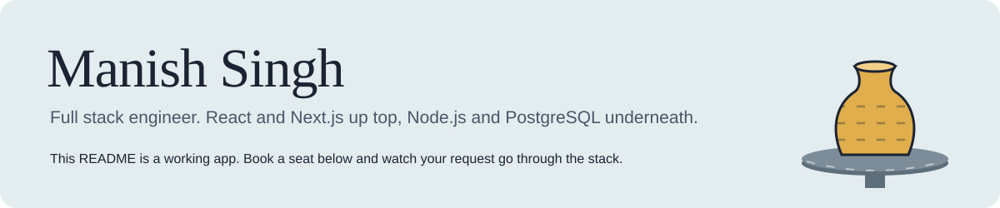

  <a href="https://manishsingh-tau.vercel.app/">Portfolio</a> &nbsp;/&nbsp;
  <a href="https://linkedin.com/in/singh-manish1">LinkedIn</a> &nbsp;/&nbsp;
  <a href="mailto:smanish14322@gmail.com">smanish14322@gmail.com</a> &nbsp;/&nbsp;
  Bhopal, India

## Book a seat at the wheel

Pick a free seat. GitHub opens an issue with your request filled in; press **Create**. About a minute later your avatar takes the seat and the Action replies on your issue. One seat per person, and two people can never get the same seat.

 
 
<a href="https://github.com/singh-manish1/singh-manish1/issues/new?title=book%20C1&body=Press%20**Create**%20to%20send%20this%20request.%20A%20GitHub%20Action%20will%20try%20to%20book%20the%20seat%20and%20reply%20here%20in%20about%20a%20minute.">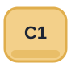</a> 
<a href="https://github.com/singh-manish1/singh-manish1/issues/new?title=book%20D1&body=Press%20**Create**%20to%20send%20this%20request.%20A%20GitHub%20Action%20will%20try%20to%20book%20the%20seat%20and%20reply%20here%20in%20about%20a%20minute.">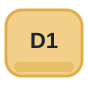</a><a href="https://github.com/singh-manish1/singh-manish1/issues/new?title=book%20D2&body=Press%20**Create**%20to%20send%20this%20request.%20A%20GitHub%20Action%20will%20try%20to%20book%20the%20seat%20and%20reply%20here%20in%20about%20a%20minute.">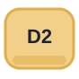</a><a href="https://github.com/singh-manish1/singh-manish1/issues/new?title=book%20D3&body=Press%20**Create**%20to%20send%20this%20request.%20A%20GitHub%20Action%20will%20try%20to%20book%20the%20seat%20and%20reply%20here%20in%20about%20a%20minute.">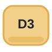</a><a href="https://github.com/singh-manish1/singh-manish1/issues/new?title=book%20D7&body=Press%20**Create**%20to%20send%20this%20request.%20A%20GitHub%20Action%20will%20try%20to%20book%20the%20seat%20and%20reply%20here%20in%20about%20a%20minute.">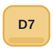</a>
 

| Time (UTC) | Who | Request | Response |
| --- | --- | --- | --- |
| | | No requests yet. Be the first. | |

## How this README works

  

The [booking workflow](.github/workflows/book.yml) uses optimistic concurrency: each run books against the latest `state.json` and pushes, and if another booking landed first the push is rejected, so it re-reads and tries again. Two clicks on the same seat can never both win. It's the guarantee I get from `SELECT … FOR UPDATE` row locks in production, built from git instead of PostgreSQL. The seat is matched from the issue title with a strict pattern and never executed.

## Experience

  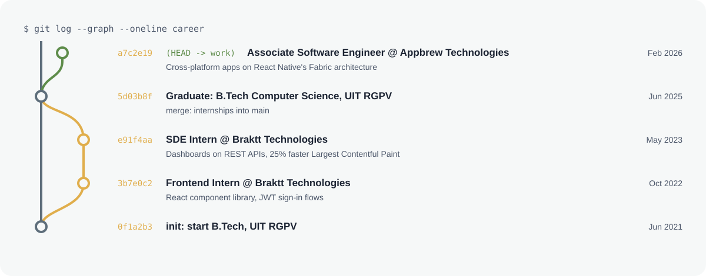

Also: ran React workshops for 35+ students at CodeCult, and 20+ sessions for 100+ people as Web Master of Asper Club.

## Projects

Each project as a trace of one real request, from the browser down to the database.

  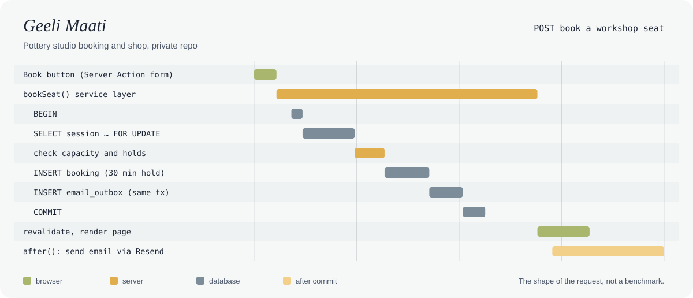

**Geeli Maati** (private, in progress). Workshop booking, a shop that ships across India and an admin dashboard. Next.js 16, PostgreSQL, Drizzle, Better Auth, UPI payments with UTR verification, a transactional email outbox, 247 Vitest tests including race-condition tests.

  <a href="https://repset.in">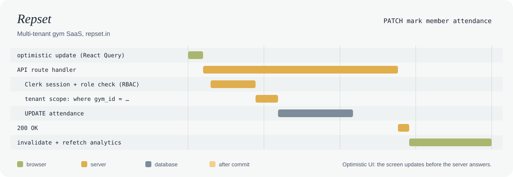</a>

**[Repset](https://repset.in)**. Multi-tenant gym management with role-based access, Razorpay billing and optimistic UI for 30% faster interactions.

  <a href="https://rachnakaar.vercel.app/">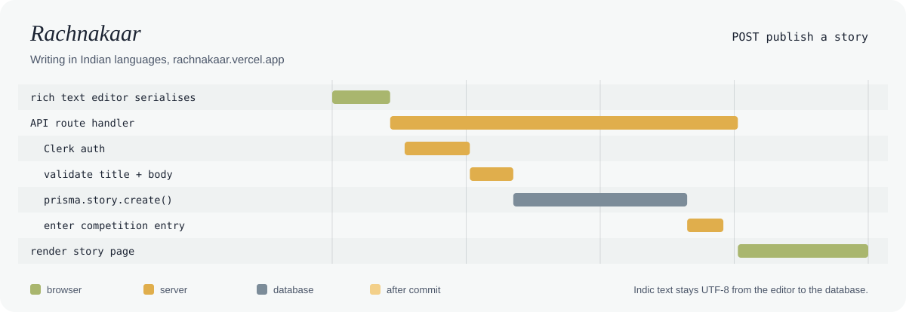</a>

**[Rachnakaar](https://rachnakaar.vercel.app/)**. A platform for Indian writers to publish in their own scripts, with a rich text editor and writing competitions.

Also built: [Onezy](https://onezy.in), an agency website, and [Gurukool](https://gurukool.tech), a learning platform that answers questions from your own PDFs.

## Skills

| Layer | What I use |
| --- | --- |
| Browser | React, Next.js, React Native, TypeScript, Tailwind CSS, React Query, Redux Toolkit, Zustand |
| Server | Node.js, Next.js Server Actions and Route Handlers, REST APIs, tRPC, Zod, GitHub Actions |
| Database | PostgreSQL, Drizzle ORM, Prisma ORM, schema design, transactions, row locking |
| Plumbing | Better Auth, Clerk, JWT, OAuth, RBAC, Razorpay, UPI, Cloudinary, Resend, Vitest |

  <picture>
    <source media="(prefers-color-scheme: dark)" srcset="https://raw.githubusercontent.com/singh-manish1/singh-manish1/output/github-contribution-grid-snake-dark.svg"/>
    
  </picture>

  

