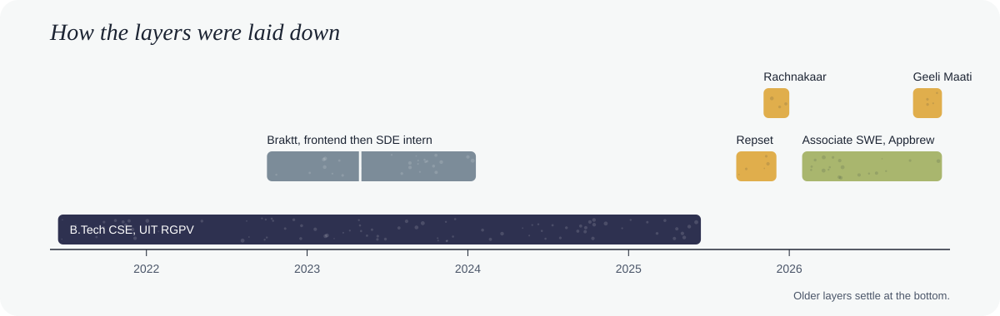
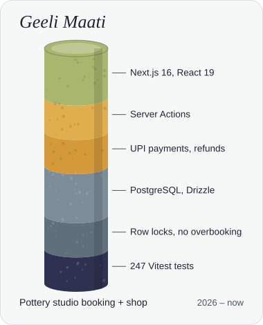
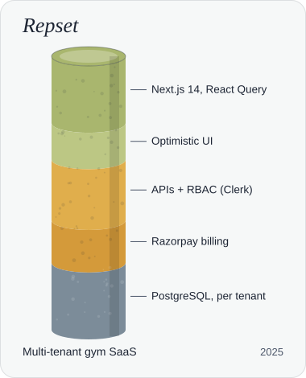
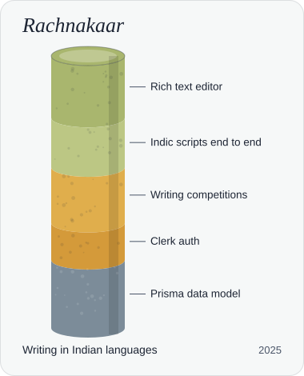

<!-- Manish Singh | Full stack engineer. Artwork in ./assets is generated by build.mjs -->

  

  <a href="https://manishsingh-tau.vercel.app/">Portfolio</a> &nbsp;/&nbsp;
  <a href="https://linkedin.com/in/singh-manish1">LinkedIn</a> &nbsp;/&nbsp;
  <a href="mailto:smanish14322@gmail.com">smanish14322@gmail.com</a> &nbsp;/&nbsp;
  Bhopal, India

I'm a full stack engineer and a 2025 Computer Science graduate. I like the whole trip a request takes: the button someone taps, the server code that checks it, and the database row that has to stay correct when two people tap at the same moment.

Right now I build mobile apps in React Native at **Appbrew**, and on the side I'm building **Geeli Maati**, a booking and shop platform for a pottery studio.

## Experience

  

- **Appbrew Technologies**, Associate Software Engineer, Feb 2026 to now. Cross-platform apps on React Native's new Fabric architecture.
- **Braktt Technologies**, frontend intern then SDE intern, Oct 2022 to Jan 2024. Dashboards on REST APIs, a 25% cut in Largest Contentful Paint, and JWT auth flows.

**Teaching.** Ran React workshops for 35+ students at CodeCult, and 20+ sessions for 100+ people as Web Master of Asper Club.

## Projects

Each project as a drill core, sampled from the interface down to the database.

  
  
  

**Geeli Maati** (private repo, in progress). Workshop booking, a shop that ships across India, and an admin dashboard in one Next.js app. PostgreSQL transactions and `SELECT … FOR UPDATE` row locks stop the last seat or the last pot from being sold twice, and race-condition tests prove it. Payments run over UPI without a gateway, and emails go out through a transactional outbox with retries.

**[Repset](https://repset.in)**. A gym management SaaS where each gym's data stays its own. Role-based access through Clerk, Razorpay billing, and React Query with optimistic updates for 30% faster interactions.

**[Rachnakaar](https://rachnakaar.vercel.app/)**. A place for Indian writers to publish stories and poems in their own scripts, with a rich text editor and writing competitions.

Also built: [Onezy](https://onezy.in), an agency website, and [Gurukool](https://gurukool.tech), a learning platform that answers questions from your own PDFs.

## Skills

| Layer | What I use |
| --- | --- |
| Interface | React, Next.js, React Native, TypeScript, Tailwind CSS, Material UI, React Query, Redux Toolkit, Zustand |
| Server | Node.js, Next.js Server Actions and Route Handlers, REST APIs, tRPC, Zod |
| Data | PostgreSQL, Drizzle ORM, Prisma ORM, schema design, transactions and row locking |
| Bedrock | Better Auth, Clerk, JWT, OAuth, role-based access, Razorpay, UPI, Cloudinary, Resend, Vitest |

## The worm's tunnels

My contribution graph, eaten one green square at a time.

  <picture>
    <source media="(prefers-color-scheme: dark)" srcset="https://raw.githubusercontent.com/singh-manish1/singh-manish1/output/github-contribution-grid-snake-dark.svg" />
    
  </picture>

  

  

